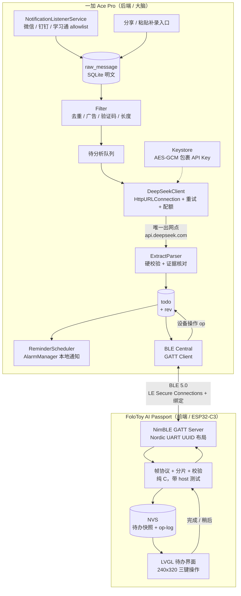

# 校园消息待办助手 · 开发计划 v1

目标：**手机做后端采集与 AI 提炼，FoloToy AI Passport 做硬件前端，全部接口本地化且经过实测可用。**

本计划的每条"事实"都标注了来源与核实状态。标 ❓ 的是还没验证、必须在对应里程碑用命令证明的项——不要把 ❓ 当成已成立。

---

## 0. 已核实的事实

| 事实 | 值 | 来源 / 状态 |
| --- | --- | --- |
| 设备 MCU / Flash | ESP32-C3，8 MB Flash，**无 PSRAM** | `ai-passport/docs/hardware-design/specifications.md` ✅ |
| 屏幕 | ST7789P3 240×320 RGB565，4-line SPI | `components/bsp/include/bsp_pins.h` ✅ |
| 按键 | 上/下/确定 三键共用一个 GPIO0 ADC 电阻梯 | 同上 ✅ |
| 音频 / 电量 / NFC | ES8311 codec、CW2017 电量计、被动 NTAG213 | specifications.md ✅ |
| 电池 | 520 mAh | 同上 ✅ |
| ESP-IDF | **已装** v5.5.3 @ `D:\DSH\esp\esp-idf-v5.5.3`；工具链 @ `C:\Users\22050\.espressif`（已占 3.33 GB，在 C 盘） | `.esp-bootstrap/activate-idf.ps1` ✅ |
| 固件已能构建 | `build/FoloToy-AI-Passport-full.bin` = 782,032 B（2026-09-30） | 构建产物 ✅ |
| 分区表 | `nvs` 0x6000 @0x9000，`phy_init` 0x1000 @0xf000，`factory` **0x7f0000** @0x10000（整 8 MB） | `partitions.csv` ✅ |
| LVGL | 9.5.0（`esp_lvgl_port` 2.9.0、`espressif/button` 4.2.0、`esp_codec_dev` 1.6.2） | `dependencies.lock` ✅ |
| NimBLE 角色 | `PERIPHERAL=y`、`GATT_SERVER=y`、`CENTRAL=n`、`OBSERVER=n`、`MAX_CONNECTIONS=1` | `sdkconfig` / `sdkconfig.defaults` ✅ |
| NimBLE 安全 | `SECURITY_ENABLE=y`、`SM_SC=y`、`SM_LEGACY=y`、`SM_LVL=0`、`MAX_BONDS=3`、`ATT_PREFERRED_MTU=256` | `sdkconfig` ✅ |
| NimBLE 绑定持久化 | `CONFIG_BT_NIMBLE_NVS_PERSIST=n` ← **必须改成 y，否则每次重启都要重新配对** | `sdkconfig.defaults` ✅ |
| BLE 内存开销（实测） | 起 BLE ≈ **60 KB** 堆；连接稳态再 ≈ 6 KB；停掉能全部归还。UI+音频跑起来后：起 BLE 前 131.2 KB → 连接态 125.2–128.9 KB | `docs/reference/shinku-chen/two-device-ble-link.md`（2026-09-18 两块板实测）✅ |
| BLE 与全屏截图不能共存 | 一张 320×240 RGB565 = 150 KB，启动时最大连续块仅 ~114 KB → 必须放 `.bss` 永久占 150 KB | 同上 ✅ |
| 中文字体流水线 | `tools/token_font/make_font.py` 从 UI 字符串字面量抽码点 → `lv_font_conv` 1.5.3 生成子集 + 码点清单头；`tests/test_token_font.py` 逐码点校验 | 已读源码 ✅ |
| 字体源 | `assets/fonts/NotoSansSC-VariableFont_wght.ttf`（17.7 MB，OFL-1.1） | 本地存在 ✅ |
| 现有字体产物体积 | 11/14/20/28 四档合计 ≈ 464 KB | `main/fonts/` ✅ |
| DeepSeek 模型 | `deepseek-flash`（= DeepSeek-V4.1-Flash），1M 上下文，最大输出 384K，**支持 JSON Output**，**思考模式默认开启** | 官方 Models & Pricing ✅ |
| DeepSeek 关思考 | OpenAI 格式：`{"thinking":{"type":"disabled"}}`（关闭后 `temperature` 等参数才……*注意*：文档说思考模式不支持 temperature/presence/frequency；`top_p` 仅在思考模式生效） | 官方 Thinking Mode ✅ |
| DeepSeek JSON Output | 需 `response_format={"type":"json_object"}` + prompt 里含 "json" + 给样例 + 合理的 `max_tokens`；**官方明说偶尔返回空 content** | 官方 JSON Output ✅ |
| DeepSeek 价格（每 1M token） | 输入命中缓存 $0.003 闲 / $0.006 峰；输入未命中 $0.15 闲 / $0.30 峰；输出 $0.60 闲 / $1.20 峰 | 官方 Pricing ✅ |
| 峰时时段 | **UTC 周一至周五 01:00–04:00 与 06:00–10:00** = 北京时间 **09:00–12:00 与 14:00–18:00**（校园通知高峰正好落在峰价） | 官方 Pricing ✅ |
| 本机磁盘 | **C: 剩 0.7 GB**；D: 剩 64.99 GB | 实测 ✅ |
| 本机网络 | `dl.google.com` **不通**、`github.com` **不通**（解析到 127.0.0.1）；`repo.maven.apache.org` ✓、`maven.aliyun.com` ✓、`mirrors.cloud.tencent.com` ✓、`mirrors.tuna.tsinghua.edu.cn` ✓、`components.espressif.com` ✓、`api.deepseek.com` ✓、`registry.npmjs.org` ✓ | 实测 ✅ |
| 已有 JDK / Android SDK / Gradle | **全都没有**（`java`/`gradle`/`adb`/`sdkmanager` 均不在 PATH，D 盘也无 JDK） | 实测 ✅ |
| 从分享页继承的用户选择（**待你确认**） | 后端机 = 一加 Ace Pro 原神限定版；硬件端 v1 = 查看待办/截止时间/来源 + 完成/稍后；采集 = 自动通知监听 + 手动粘贴/分享补录 + 标示采集状态 | 分享页 ⚠️ 未由你当面确认 |

---

## 1. 先说做不到的（不可用清单）

这些不是"待优化"，是这套架构的物理/平台边界。计划不承诺它们，UI 里也不装作能拿到。

1. **静音/免打扰群、开启了"隐藏通知内容"的会话、以及任何没产生通知的消息 → 采不到。** 通知监听只能拿到"系统真的弹了通知"的那些。补救只有手动分享/粘贴。
2. **装 App 之前的历史消息 → 采不到。** 通知监听没有历史回溯能力。
3. **被 ColorOS 杀掉后台期间的消息 → 采不到。** 只能靠白名单 + 前台服务把被杀概率压到最低，72 小时验收就是去量这个概率。
4. **图片/语音/文件类通知 → 只能拿到标题文案，拿不到内容。**（能拿到标题往往也够：`[图片]` 常常伴随文字说明。）
5. **模型推断的日期会错。** 所以任何 `due_iso` 都必须过本地硬校验，不确定的一律进"待确认"，**不进自动提醒**。
6. **DeepSeek JSON Output 偶尔返回空 content（官方文档明说）。** 必须当失败处理并重试，不能当"没有待办"。
7. **断网时新消息只能标"待分析"**，不会自动补上（网络恢复后排队消费）。
8. **不承诺服务端不重复计费。** 请求超时后服务端可能已计费，我们只能本地按消息内容哈希去重，避免重复建待办。
9. **不做全库加密。** 本地 SQLite 明文（见 §5 的取舍说明）。

---

## 2. 架构



**角色分工的硬决定：**

- **手机是唯一的事实来源**（todo 的 id 与 `rev` 由手机生成），设备只持有快照 + 一份待回传的操作日志。
- **设备侧离线也要能用**：待办快照落 NVS，拔掉手机也能翻看、标完成；操作进 op-log，重连后回传。
- **出网点只有 1 个**：`api.deepseek.com`。没有自建服务器，没有第三方统计，没有云同步。

---

## 3. 接口总览（"所有接口本地化"的落实）

| # | 接口 | 方向 | 传输 | 认证 / 保护 | 什么离开手机 |
| --- | --- | --- | --- | --- | --- |
| I1 | 通知采集 | 系统 → App | 进程内 `NotificationListenerService` | 系统级"通知使用权"授权 | 无 |
| I2 | 手动补录 | 分享/粘贴 → App | 进程内 `ACTION_SEND` / `ACTION_PROCESS_TEXT` | 无 | 无 |
| I3 | AI 提炼 | App → DeepSeek | **HTTPS，唯一出网点** | Bearer Key（Keystore 加密）；系统证书校验；禁止重定向出域 | **仅**待分析的通知正文 + 固定 system prompt |
| I4 | 同步 | 手机 ↔ 设备 | **BLE GATT，仅此一条无线链路** | LE Secure Connections + MITM（屏幕 6 位配对码）+ bonding；写特征要求 `ENC\|AUTHEN` | 待办字段 + 来源标签 + 手机预渲染的标题位图 |
| I5 | 本地库 | App 内 | SQLite | OS 应用沙箱 | 无 |
| I6 | 提醒 | App → 系统 | `AlarmManager` + 本地通知 | 无 | 无 |

**明确不存在的接口**：不向局域网开 HTTP 端口、不做 Wi-Fi 直连、不注册任何第三方 SDK、不申请 `READ_SMS`/`READ_CONTACTS`/存储权限。API Key 永不通过 BLE 传输、永不进固件。

---

## 4. 接口契约

### 4.1 通知采集（I1）—— Android 内部边界

```java
// 只采这 3 个包
static final Set<String> ALLOW = Set.of(
    "com.tencent.mm",            // 微信
    "com.alibaba.android.rimet", // 钉钉
    "com.chaoxing.mobile"        // 学习通
);
```

每条落库字段：`pkg`、`pkg_label`、`posted_at`(epoch ms)、`title`、`text`（`EXTRA_TEXT` 与 `EXTRA_BIG_TEXT` 取长者）、`sub_text`、`category`、`notif_key`、`content_hash`。

采集后立刻做的本地过滤（纯 Java，可单测）：

- 同 `notif_key` 内容未变 → 丢弃（通知更新会重复回调）。
- 命中验证码/支付/营销正则 → 丢弃（`\d{4,6}\s*(验证码|动态码)`、`已收款|支付成功|红包`、`优惠|促销|领券`）。
- 正文长度 < 4 → 丢弃（纯表情/单字）。
- 归一化后 `content_hash` 去重（同一条消息在推送重试时会重复出现）。

**脱敏（默认关，开关在设置页）**：正文里的手机号、身份证号、学号（`\b\d{8,12}\b` 中带"学号"上下文的）替换为 `****`。

### 4.2 AI 提炼（I3）—— 唯一出网点

```
POST https://api.deepseek.com/chat/completions
Authorization: Bearer <Keystore 解出的 Key>
Content-Type: application/json
```

请求体（固定这个形状，不要"聪明地"变）：

```json
{
  "model": "deepseek-flash",
  "thinking": { "type": "disabled" },
  "response_format": { "type": "json_object" },
  "max_tokens": 2048,
  "stream": false,
  "messages": [
    { "role": "system", "content": "<见下，逐字节固定>" },
    { "role": "user", "content": "当前时间：2026-10-08T14:03:00+08:00\n待分析通知：\n1) [微信/班级群] ...\n2) [钉钉/辅导员] ..." }
  ]
}
```

- `thinking: disabled`：**必须显式关**。默认是开的，开了会产出 `reasoning_content`，白付输出 token 且更慢。
- **system prompt 逐字节固定**是省钱手段，不是洁癖：前缀稳定才能命中上下文缓存（$0.30 → $0.006 /1M，差 50 倍）。当前时间放在 user 消息里，别塞进 system。
- `max_tokens: 2048`：官方提醒要给够，防 JSON 被截断。合批 10 条时够用。

遇到的处理（硬性）：

| 情况 | 处理 |
| --- | --- |
| HTTP 400 | 不重试。落 `analysis_run` 记录，标记该批次为"格式失败"，进待确认 |
| HTTP 401 | 立即暂停所有调用，通知栏常驻提示"API Key 失效"，等用户改 Key |
| HTTP 402 | 立即暂停，提示"余额不足" |
| HTTP 429 / 500 / 503 / 超时 | 指数退避：2s → 6s → 18s，各带 ±30% 抖动，最多 3 次 |
| 200 但 `content` 为空/不是合法 JSON | 当作失败，**重试 1 次**（prompt 不变），仍失败则进待确认 |
| 200 且 JSON 合法 | 走 §4.3 的本地硬校验，**不直接信** |

超时：连接 10 s，读 60 s。`HttpURLConnection` 设 `setInstanceFollowRedirects(false)`；若响应码是 3xx 一律当失败（防被引到别的域）。

### 4.3 待办 JSON 契约 `todo-extract/1`（手机 ↔ 模型）

模型只负责"读文本 → 出候选"，**日期推断的可信度由本地规则裁决，不由模型自评裁决**。

```json
{
  "items": [
    {
      "title": "提交数据结构实验报告",
      "course": "数据结构",
      "kind": "homework",
      "due_text": "本周五23:59前",
      "due_iso": "2026-10-09T23:59:00+08:00",
      "evidence": "请在10月9日23:59前提交实验报告",
      "confidence": 0.82
    }
  ],
  "ignored": [
    { "index": 2, "reason": "闲聊" }
  ]
}
```

本地硬校验（`ExtractParser`，全部失败即进待确认，绝不静默丢）：

1. `evidence` 必须能在原文里找到（两边归一化空白与全半角后做子串匹配）。**找不到 → 丢弃该条**，这是防幻觉的主闸门。
2. `kind` ∈ {homework, exam, notice, other}，否则降级为 `other`。
3. `due_iso` 能解析且落在 `[now - 1天, now + 400天]`，否则置 `null`。
4. 若 `due_iso != null` 且 `due_text` 与 `due_iso` 明显冲突（例如 `due_text` 含"下周三"但 `due_iso` 落在本周）→ 置 `null`。
5. `confidence < 0.6` 或 `due_iso == null` → 状态 `PENDING_CONFIRM`（**不自动建提醒**）。
6. `title` 截到 80 字；`items` 最多 20 条；`course` 最多 20 字。
7. 同一 `content_hash` 的批次只落一次（按消息版本去重）。

### 4.4 BLE 同步契约 `campus-sync/1`（I4）

**角色**：设备 = peripheral + GATT server（现有 sdkconfig 正好是 `PERIPHERAL=y` / `GATT_SERVER=y` / `CENTRAL=n` / `OBSERVER=n`，**不需要改角色**）；手机 = central + GATT client。

**UUID**：沿用仓库已验证的 Nordic UART 布局，好处是手机端和现成 BLE 调试工具都能直接认出来。

| 用途 | UUID | 属性 |
| --- | --- | --- |
| Service | `6e400001-b5a3-f393-e0a9-e50e24dcca9e` | — |
| RX（手机 → 设备） | `6e400002-b5a3-f393-e0a9-e50e24dcca9e` | Write **With Response**，权限 `ENC \| AUTHEN` |
| TX（设备 → 手机） | `6e400003-b5a3-f393-e0a9-e50e24dcca9e` | Notify，权限 `ENC \| AUTHEN`（按仓库经验：**notify-only 特征也必须有 access_cb，否则整个 service 注册失败并报 `ble_gatts_count_resources rc=3`**） |

**可靠性策略（关键设计，和棋类那套 stop-and-wait 不同）：**

链路天然不对称，直接用它的性质，别自己造轮子：

- **手机 → 设备**：用 `Write With Response`，ATT 层每个分片自带确认 → 传输出错会立即返回错误码，应用层只需要"整包校验 + 整包重传"。
- **设备 → 手机**：`Notify` 没有确认 → 设备发完一包后，等手机回写一个 `ACK`；3 s 没等到就重发，最多 3 次。

**分片头**（手机→设备每片、设备→手机每包都带）：

```
偏移  长度  字段
0     1     magic = 0xA7
1     1     ver = 1
2     1     type
3     1     flags
4     2     transfer_id   (LE u16，每次传输自增)
6     2     index         (LE u16，从 0 起)
8     2     total         (LE u16，分片总数)
10    2     payload_len   (LE u16)
12    2     payload_crc16 (LE u16，**整个 payload** 的 CRC16-CCITT，不是本片的)
14    n     payload
```

| type | 含义 | 载荷 |
| --- | --- | --- |
| 0x01 | `HELLO` | 协议版本、固件版本、字库版本、设备时钟 |
| 0x02 | `TODO_SNAPSHOT` | 全量待办 JSON（手机→设备） |
| 0x03 | `TODO_DELTA` | 增量（新增/修改/删除 id 列表） |
| 0x04 | `OP` | 设备操作（设备→手机）：`{todo_id, action: done/snooze, snooze_min, dev_seq}` |
| 0x05 | `ACK` | `{transfer_id, status: ok/crc_fail/parse_fail}` |

**分片长度**：手机 `requestMtu(247)` → ATT MTU 247 → 单次可写 244 B；减去 14 B 头 = **每片 230 B**。**不要写死 MTU**：真机协商结果记在 M3 验收里，按协商值算。ESP32-C3 的 2M PHY 已在 sdkconfig 打开（`CONFIG_BT_NIMBLE_LL_CFG_FEAT_LE_2M_PHY=y`），Android 侧可选启用。

**全量同步的体量**：50 条待办 × ~300 B ≈ 15 KB（含标题位图，见 §6.3）→ 约 65 片。用"连续写 + 末片校验"，几秒内完成。**全量同步只在首连和版本不一致时发生**，日常走增量（1–2 条，几百字节）。

**设备侧持久化**：待办快照 + op-log 存 NVS。
- 快照 ≤ 16 KB（`nvs` 分区 0x6000 = 24 KB，装得下；若不够，见下方 ponytail 说明）。
- op-log 环状，最多 200 条 × 12 B = 2.4 KB，写满覆盖最旧。
- **不改分区表**。理由：这几 KB 用 NVS 足够，为它开一个新 data 分区纯属给自己加一个要验证的契约。（`ponytail:` 若快照将来超过 ~20 KB，再考虑加 `storage` data 分区或改用 `esp_littlefs`；现在的上限是 NVS 单 blob 与 24 KB 分区容量。）

### 4.5 本地存储（I5）

**用平台自带的 `SQLiteOpenHelper`，不引 Room。** Room 会带进注解处理器 + KSP + 一堆 androidx，对这个 4 张表的小库不值。（`ponytail:` 若将来查询复杂度上来了再换 Room，现在的最短路径就是把 SQL 写清楚。）

```sql
raw_message(id INTEGER PK, pkg TEXT, pkg_label TEXT, posted_at INTEGER,
            title TEXT, text TEXT, category TEXT, notif_key TEXT,
            content_hash TEXT UNIQUE, state TEXT,   -- new|queued|analyzed|skipped
            ingest TEXT)                            -- auto|share|paste
todo(id INTEGER PK, raw_id INTEGER, title TEXT, course TEXT, kind TEXT,
     due_iso INTEGER NULL, due_text TEXT, evidence TEXT, confidence REAL,
     status TEXT,     -- active|done|dismissed|pending_confirm
     rev INTEGER, created_at INTEGER, updated_at INTEGER, source_label TEXT)
analysis_run(id INTEGER PK, started_at INTEGER, model TEXT, req_bytes INTEGER,
             in_tokens INTEGER, out_tokens INTEGER, cache_hit_tokens INTEGER,
             http_status INTEGER, outcome TEXT, duration_ms INTEGER)
device_op_log(dev_seq INTEGER PK, todo_id INTEGER, action TEXT,
              snooze_min INTEGER, applied_at INTEGER)
setting(key TEXT PK, value TEXT)
```

每日配额在 `analysis_run` 上按当日汇总判定，不另建表。

### 4.6 提醒（I6）

- `AlarmManager.setExactAndAllowWhileIdle()` + 本地通知；`due_iso` 前 24 h 与 1 h 各一次。
- 只有 `status=active` 且有 `due_iso` 的才排提醒；`pending_confirm` 永不自动提醒（人工确认后转 `active`）。
- 静默时段（默认 23:30–06:30）不弹通知，改为静默写入列表。
- 权限：`POST_NOTIFICATIONS`（API 33+ 运行时申请）、`SCHEDULE_EXACT_ALARM` + `USE_EXACT_ALARM`。

---

## 5. 安全设计

| 威胁 | 对策 | 明确**不做**的 |
| --- | --- | --- |
| 待办正文被第三方看到 | 只走 DeepSeek 官方 HTTPS；无自建服务器；系统证书校验；禁跨域重定向；本地先过滤无关/重复内容，只发必要正文 | 不做端到端加密上传——模型必须读原文，做不到，不假装能做到 |
| API Key 泄漏 | Android Keystore 生成不可导出 AES 密钥 → AES/GCM 加密后存私有文件；Key 不写源码/`BuildConfig`/日志/固件；日志脱敏；**绝不通过 BLE 传** | 不引已废弃的 `androidx.security:security-crypto`，用 Keystore + ~20 行加解密 |
| BLE 中间人 / 重放 | LE Secure Connections + MITM：设备屏幕显示 6 位配对码，手机输入；写/通知特征要求 `ENC\|AUTHEN`；开 `NVS_PERSIST=y` 让绑定跨重启存活 | **不做应用层二次加密**。链路已是 LE SC（ECDH + AES-CCM），再套一层 AES-GCM 没有对应威胁，只增加代码和堆占用——设备只有 ~125 KB 可用堆，这钱不花 |
| 设备丢失后待办可读 | 待办内容本身不涉密（作业/考试通知），接受 BLE 绑定 + 设备物理持有 | 不做全库 SQLCipher：要引 native 依赖、拖慢构建、且保护的是"手机已解锁后"的场景 |
| 模型幻觉造出不存在的待办 | `evidence` 必须是原文子串；日期范围校验；置信度阈值；不确定进待确认 | 不把模型自评的 `confidence` 当唯一判据 |
| 费用失控 | 每日请求/token 上限（下方）；合批；system prompt 固定以命中缓存；错误码暂停 | 不承诺服务端不重复计费，只做本地幂等去重 |
| 误采集 | 只 allowlist 3 个包；验证码/支付/营销过滤；可关自动分析；提供"发送内容预览" | 不申请短信/通讯录/存储权限 |

**费用上限（写进代码的硬闸）**：每日 ≤ 60 次请求、输入 ≤ 300k tokens、输出 ≤ 60k tokens。
最坏情况（全部峰价、全部未命中缓存）：`300k × $0.30/1M + 60k × $1.20/1M = $0.162 ≈ ¥1.15/天`，**月天花板 ≈ ¥35**。
典型情况（30 次合批/天，北京时间 19:00 后闲时）：**≈ ¥0.01/次，≈ ¥10/月**。

---

## 6. 手机端设计

### 6.1 依赖：**0 个第三方运行时依赖**

| 需求 | 用什么（全部是 framework API） |
| --- | --- |
| 通知监听 | `NotificationListenerService` |
| 本地库 | `SQLiteOpenHelper` |
| HTTP | `HttpURLConnection`（Android 内部就是 OkHttp） |
| JSON | `org.json`（framework 内置） |
| BLE | `android.bluetooth.le.*` |
| 定时 | `AlarmManager` |
| 网络状态 | `ConnectivityManager` |
| 密钥 | `AndroidKeyStore` + `javax.crypto` |
| UI | 原生 `Activity` + `View`（不引 Compose / appcompat） |

唯一依赖是 `testImplementation junit:4.13.2`（只进测试 classpath，不进 APK）。

这不是清教徒式的洁癖，是三个实际好处：Gradle 缓存从几 GB 压到几百 MB（C 盘只剩 0.7 GB）、离线可构建、没有要审计的第三方代码。

### 6.2 模块与文件

```
android/app/src/main/java/dev/campus/todo/
  MainActivity.java        待办列表 + 设置（Key、开关、配额用量、设备配对）
  NotifListener.java       I1：allowlist 采集 → Filter → 入库
  ShareActivity.java       I2：ACTION_SEND / ACTION_PROCESS_TEXT 补录
  RawStore.java            SQLiteOpenHelper，4 张表 + 迁移
  Filter.java              [纯 Java] 去重/正则过滤/脱敏
  DeepSeekClient.java      I3：HTTP、超时、错误映射、退避、配额闸门
  ExtractParser.java       [纯 Java] §4.3 全部硬校验
  Analyzer.java            队列消费 + 合批（默认 10 条/次）+ 每日配额
  TodoRepo.java            待办 CRUD + rev 自增
  ReminderScheduler.java   I6：精确闹钟 + 通知
  SyncService.java         前台服务（FOREGROUND_SERVICE_CONNECTED_DEVICE）
  BootReceiver.java        开机 / 网络恢复拉起
  ble/BleClient.java       central：扫描（按 service UUID）→ 连接 → createBond → requestMtu → 分片写 → 收 notify → ACK
  ble/BleFrames.java       [纯 Java] §4.4 帧编解码 + CRC16-CCITT
  ble/TitleRenderer.java   把待办标题渲成 4bpp alpha 位图（见 §6.3）
  secure/KeyVault.java     Keystore AES-GCM 包裹/解包
android/app/src/test/java/dev/campus/todo/
  FilterTest.java  ExtractParserTest.java  BleFramesTest.java  TitleRendererTest.java
```

`[纯 Java]` 的四个类不碰 Android API，因此 `gradle test` 在 PC 上直接可跑，不需要模拟器。

### 6.3 ⚠ 动态中文显示方案 —— **需要你拍板**

待办标题是**任意中文**（课程名、老师名、群昵称），而现有的字体流水线只覆盖**静态 UI 文案**。这是整个项目最大的"能不能显示出来"风险，必须现在决定：

**方案 A：设备内置汉字子集字库**
- 生成 GB/T 2312 一级字库（3755 字）× 14px、20px 两档，2bpp ≈ 560 KB。
- 用 `lv_font_conv --format bin` 出二进制，`target_add_binary_data()` 嵌进固件，LVGL 9 用 `lv_binfont_create_from_buffer()` 加载。**不用改分区表。**
- 优点：设备可自由排版/换行/翻页；BLE 载荷小（只传文本）。
- 缺点：一级字库外的字（生僻名、emoji、假名）显示为占位符；生成产物 560 KB 进仓库；字体工具链风险全压在固件侧。

**方案 B（推荐）：静态文案用字库，动态标题由手机预渲染位图**
- 设备侧字体仍然只有几十个静态文案码点（"完成/稍后/截止/来源/待确认"等）——**现有流水线直接覆盖，`test_token_font.py` 原样复用**。
- 待办标题在手机上按设备面板宽度排版、渲成 **4bpp alpha 位图**（LVGL `LV_COLOR_FORMAT_A4`，`recolor` 上色），随同步下发。
- 优点：**任意文字 100% 显示正确**（手机有完整字体），设备侧零字体风险，设备代码更少（画图，不排中文）。
- 缺点：每条标题 ~1–2 KB，全量同步 ~75 KB（约 65 片，几秒）；设备不能对标题重新排版（字号/宽度固定），文字不能动态滚动。
- 风险低：位图渲染在 Android 上是保证成功的；设备端只是 `lv_image` + recolor。

**我的建议是 B**：它把唯一"可能整个项目做不出来"的风险（设备上把任意中文渲对）换成了确定能成的操作，代价只是全量同步时多传几十 KB，而全量同步本来就很少发生。B 下你仍然可以在 M5 之后按需给标题加上 A 的静态字库做兜底。

### 6.4 权限清单（一个不多）

```
INTERNET, ACCESS_NETWORK_STATE
POST_NOTIFICATIONS
FOREGROUND_SERVICE, FOREGROUND_SERVICE_CONNECTED_DEVICE
BLUETOOTH_SCAN (usesPermissionFlags="neverForLocation"), BLUETOOTH_CONNECT
RECEIVE_BOOT_COMPLETED
SCHEDULE_EXACT_ALARM, USE_EXACT_ALARM
+ service 声明 BIND_NOTIFICATION_LISTENER_SERVICE
```
不申请：`READ_SMS`、`READ_CONTACTS`、`READ_EXTERNAL_STORAGE`、`QUERY_ALL_PACKAGES`。

**minSdk**：默认 **31（Android 12）** —— 这样蓝牙权限只有一套模型，不需要为 API ≤30 写兼容分支。
⚠ 这取决于你手机的 Android 版本，`❓` 待你确认（见 §11 决策 1）。

### 6.5 ColorOS 保活（必须引导用户手动设，代码解决不了）

App 里做一次性引导页 + 一键跳转设置：

1. 设置 → 电池 → 关闭"睡眠待机优化"
2. 设置 → 应用 → 应用管理 → 本应用 → 耗电管理 → **允许完全后台行为**
3. 设置 → 应用 → 自启动 → 允许本应用
4. 最近任务里**锁定**本应用卡片
5. 关于手机 → 版本号 ×7 开开发者选项 → 关闭"不保留活动"（如果被开过）

前台服务类型用 `connectedDevice`（它真的在维持 BLE 连接），常驻低优先级通知用于采集状态显示，不用来发广告式提醒。

---

## 7. 固件端设计

### 7.1 工程形态：独立 IDF 工程，只读引用 BSP

```
campus-todo/firmware/
  CMakeLists.txt          # EXTRA_COMPONENT_DIRS = ../../ai-passport/components
  sdkconfig.defaults      # 复制 ai-passport 的，改 2 项
  partitions.csv          # 原样复制（8MB，factory 0x7f0000）
  main/
    campus_main.c         启动、NVS、LVGL、按键回调注册
    campus_sync.c/.h      NimBLE GATT server + 帧协议（纯 C，host 可测）
    campus_frames.c/.h    [纯 C] 帧编解码 + CRC16（host 测试）
    campus_store.c/.h     NVS 快照 + op-log
    campus_ui.c/.h        LVGL 界面（必须是重新设计的，不复用 demo 菜单）
    campus_font_chars.h   静态文案码点清单（生成）
    fonts/                静态文案字体（生成）
  tools/font/make_font.py # 复制 ai-passport 的，改 UI_SOURCES 与输出名
  tests/                  host 测试（frames / store / 协议状态机）
```

**为什么是独立工程而不是往 ai-passport 里加第三个 App**：`ai-passport/main/CMakeLists.txt` 目前有**未提交的在飞改动**（正在做 Token Passport），插进去会互相踩；而且你选的就是独立目录。BSP 通过 `EXTRA_COMPONENT_DIRS` 只读引用，**ai-passport 仓库一个字节都不动**。
代价：这个工程不能单独 clone 构建，必须有兄弟目录 `ai-passport`。写进 README 的 bootstrap 检查里。（`ponytail:` 若将来要独立分发，再把 bsp 做 submodule；现在跨目录引用是零改动的最短路径。）

**sdkconfig 需要改的 2 项**：

```ini
CONFIG_BT_NIMBLE_NVS_PERSIST=y      # 否则重启就要重新配对
CONFIG_BT_NIMBLE_MAX_BONDS=3        # 保留：允许换手机时重配
```

**不要动**：`ROLE_CENTRAL=n` / `ROLE_OBSERVER=n`（手机是 central，设备只做 server）、`MAX_CONNECTIONS=1`。

**绝对不要加截图功能**：全屏 RGB565 缓冲区 150 KB 会和 BLE 抢堆，仓库里已实测二者不能共存（`two-device-ble-link.md`）。

### 7.2 内存预算（按实测值推算）

UI + 音频跑起来后可用堆 ≈ 191.9 KB；起 BLE 花 ~60 KB → 稳态 ~125 KB；单个连接再 ~6 KB。

| 用途 | 估算 |
| --- | --- |
| 起 BLE + 连接（实测） | −66 KB |
| 待办快照解析缓冲（50 条 JSON ≈ 16 KB，留 2 倍） | −32 KB |
| 4bpp 标题位图缓存（只缓存当前页 5 条 ≈ 8 KB） | −8 KB |
| LVGL 界面与绘制 | 已包含在 191.9 KB 基线里 |
| **余量** | **≈ 85 KB** |

余量健康。但要在 M3/M4 真机上把这些数字量出来，而不是信这段推算。

### 7.3 界面（必须重新设计，不复用 demo 菜单）

240×320 竖屏、三键（上 / 下 / 确定）：

- **列表页**：每行 = 标题（手机渲染位图）+ 截止时间 + 来源标签（微信/钉钉/学习通）+ 状态点（待确认用警示色）。
  - 上/下翻行，确定键进入详情。
- **详情页**：完整标题、截止时间、来源、原文依据（`evidence`）、`due_text` 原文表述。
  - 确定短按 = 标记完成；确定长按（500 ms）= 稍后提醒菜单（30 分钟 / 2 小时 / 明天）。
- **状态条**：采集状态（"已同步 14:03" / "待同步 3 条" / "等待配对"）、BLE 连接图标、电量。
- **配对页**：显示 6 位配对码，等手机输入。
- 字体：静态文案走生成字库；标题走位图（方案 B）。**上线前必须跑 `make_font.py --check` 与 `tests/test_token_font.py`**。

---

## 8. 环境准备（M0）—— 已按本机网络实测过的路径

`dl.google.com` 与 `github.com` 在本机不可达，所以**不能用官方 `sdkmanager` 直接装**，全部走国内镜像手动落盘。所有东西装到 **D 盘**，C 盘只剩 0.7 GB。

```powershell
# 1) JDK 17（Adoptium via 清华镜像）→ D:\Android\jdk
#    OpenJDK17U-jdk_x64_windows_hotspot_17.0.20.1_1.zip
#    https://mirrors.tuna.tsinghua.edu.cn/Adoptium/17/jdk/x64/windows/
# 2) Android SDK 组件（腾讯镜像 mirrors.cloud.tencent.com/AndroidSDK/，均已实测 200）
#    commandlinetools-win-16111833_latest.zip   → D:\Android\sdk\cmdline-tools\latest
#    platform-tools_r37.0.1-win.zip             → D:\Android\sdk\platform-tools
#    platform-36_r02.zip                        → D:\Android\sdk\platforms\android-36
#    build-tools_r36_windows.zip                → D:\Android\sdk\build-tools\36.0.0
#    不装 emulator / system-image（省约 10 GB）
# 3) Gradle 8.11.1（腾讯镜像 https://mirrors.cloud.tencent.com/gradle/）
$env:ANDROID_HOME      = 'D:\Android\sdk'
$env:ANDROID_USER_HOME = 'D:\Android\.android'
$env:GRADLE_USER_HOME  = 'D:\Android\gradle'
$env:JAVA_HOME         = 'D:\Android\jdk'
```

- SDK 包要按目录结构手工解包（`platform-36` 解出来是 `android-36/`，`build-tools` 要重命名成 `36.0.0`）。
- **许可证**：官方 `sdkmanager --licenses` 需要访问 `dl.google.com`，走不通。所以要由**你在 M0 明确授权后**，把 `android-sdk-license` 的接受记录写入 `D:\Android\sdk\licenses\android-sdk-license`。这一步代表你接受 <https://developer.android.com/studio/terms>，**我不会替你决定，也不会因为分享页里有一句"同意"就当你的授权**。
- AGP 从阿里云 Google 镜像取（`https://maven.aliyun.com/repository/google`，AGP 8.9.2 已实测 200）；`build.gradle` 的 `repositories` 只配 `maven.aliyun.com` + `repo.maven.apache.org`，不配 `google()`（那个域不通，配了只会让构建每隔一阵卡超时）。
- + `npm.cmd i -g lv_font_conv@1.5.3`（M4 用；npm 源可达）。
- ESP-IDF 已就绪，激活方式：`$c = Get-Content -Raw ai-passport\.esp-bootstrap\activate-idf.ps1; Invoke-Expression $c`。

**预计占用**：SDK ~1.2 GB + Gradle 缓存 ~0.6 GB + JDK ~0.4 GB ≈ **2.2 GB，全在 D 盘**。

---

## 9. 里程碑与验收

每个里程碑都写明"什么算过了"。没跑过的命令不能写成 PASS。

### M0 · 环境（0.5 天）
- 交付：JDK + SDK + Gradle 落盘；`gradle -v`、`adb version`、`sdkmanager --list_installed` 有输出。
- **验收**：`gradlew :app:assembleDebug` 能在一个空工程上跑通（证明 AGP/Gradle/镜像这三角真的能解析依赖）。
- 关卡：你需要确认 Android 版本 + 授权接受 SDK 许可。

### M1 · 采集与本地库，不接 AI（2 天）
- 交付：`NotifListener` + `Filter` + `RawStore` + `ShareActivity` + 待办列表空壳。
- 验收：
  - `gradle test` 跑过 `FilterTest`（去重/验证码/广告/长度 四类用例）。
  - 真机：微信来一条消息 → `raw_message` 多一行；同一条通知更新 3 次 → 只留 1 行；验证码通知 → 被过滤。
  - 从微信长按消息 → 分享 → 本应用 → 能入库并标 `ingest=share`。
  - 通知使用权关闭时，App 明确显示"未授权，采集已停"，不静默失败。

### M2 · DeepSeek 接入与费用控制（2.5 天）
- 交付：`KeyVault` + `DeepSeekClient` + `ExtractParser` + `Analyzer` + 配额闸门。
- 验收：
  - `gradle test` 跑过 `ExtractParserTest`（证据子串、日期越界、due_text/due_iso 冲突、低置信度、空 content 各一组）。
  - 真机：设置页填 Key → 落库前先看到"发送内容预览"→ 点分析 → 待办出现在列表，`analysis_run` 记到 token 数。
  - **空 content 注入**：用一个返回空 content 的假端点，验证会重试 1 次并最终进待确认，而不是当成"没有待办"。
  - **错误码注入**：假端点返回 401 / 402 / 429 / 500，验证 401/402 立即暂停并提示、429/500 走退避、3 次后放弃。
  - 断网：新通知标 `queued`，恢复网络后自动消费。
  - 配额：把日上限临时改成 2，第 3 次请求被拦并提示。
  - 费用：跑一天，`analysis_run` 汇总出的 token 数与平台账单同量级。

### M3 · 固件 BLE 与协议（3 天）
- 交付：`campus_sync` + `campus_frames` + host 测试 + 配对流程。先不做 UI。
- 验收：
  - `./tools/validate.sh --firmware`（在 campus-todo 工程里对应的 gate）通过，产出合并固件。
  - **PC 端 Python + `bleak` 对端脚本**（照仓库 `two-device-ble-link.md` 的做法）能：扫描到设备 → 配对（设备屏幕显示码）→ 协商 MTU（记录真机实测值）→ 写 15 KB 分片 → 设备回报 `ACK ok`。
  - 注入 CRC 错误 / 缺片 / 乱序，验证设备回 `crc_fail` 并让对端重传，最终一致。
  - `campus_frames` 的 host 测试覆盖：分片重组、CRC 校验失败、seq 回绕、超长 payload 拒绝。
  - 重启设备后**不需要重新配对**（这就验证了 `NVS_PERSIST=y` 真的生效）。
  - 串口日志量出实际可用堆，与 §7.2 的推算对比。

### M4 · 固件界面与持久化（3 天）
- 交付：`campus_ui`（重新设计的界面）+ `campus_store` + 静态文案字库。
- 验收：
  - `make_font.py --check` + `tests/test_token_font.py` 通过（逐码点覆盖）。
  - 真机目视：每一屏的中文都**不是方框**（截图 + 串口日志，两者都要）。
  - 断电重启后待办仍在列表里（NVS 生效）。
  - 三键：翻行、进详情、标完成、长按稍后，全部无阻塞（按键回调不干重活）。
  - 离开界面时任务/定时器/回调全部注销（照仓库规则），反复进出 20 次不出错、堆不持续下降。

### M5 · 端到端联调（3 天）
- 交付：手机 ↔ 设备完整闭环。
- 验收：
  - 手机产生的待办几秒内出现在设备上；在设备上标完成 → 手机上该待办变 `done`（并取消提醒）。
  - 设备断连状态下标完成 → 重连后 op-log 回传成功，不丢、不重复。
  - 手机上删除/修改待办 → 设备增量更新正确。
  - 强制解除绑定 → 设备回到"等待配对"页，重新配对后能继续同步。
  - 全量同步 50 条待办的耗时与 BLE 流量有实测数字。

### M6 · 稳定性与验收（3 天，含 72 小时挂机）
- 验收：
  - **72 小时后台存活**：手机静置 72 h，每 6 h 触发一条测试通知。导出 `raw_message`/`todo` 计数 + logcat 片段。**记录漏采率、是否被系统杀死、耗电百分比。** 漏采就如实写进报告，不美化。
  - 错误注入全表复跑（§4.2 那张表）。
  - 关机重启、飞行模式开关、蓝牙开关、手机重启 → 各项自恢复。
  - 费用实测：72 h 的 token 用量与账单对照。
  - 交付字段照仓库规矩分开写：

```
Build:        PASS / FAIL / NOT RUN
Host tests:   PASS / FAIL / NOT RUN
Device tests: PASS / FAIL / NOT RUN
Unverified:   剩余需要板子、仪器或你本人确认的项
```

### M7 · 交付（1 天）
- `release/campus-todo-<ver>.apk`
- `release/AI-Passport-campus-<ver>-full.bin`（**合并镜像，可从 0x0 刷写**；刷写前单独征求你确认）
- 源码 + `docs/TEST-REPORT.md`（含上面四个字段 + 72h 实测数据 + 已知不可用清单）
- `docs/USER-GUIDE.md`（ColorOS 白名单怎么设、Key 怎么填、哪些消息采不到）

**总工期约 18 个工作日**（不含你决策与真机等待时间）。

---

## 10. 测试计划

| 层 | 手段 | 在哪跑 |
| --- | --- | --- |
| 纯逻辑 | `FilterTest` / `ExtractParserTest` / `BleFramesTest` / `TitleRendererTest`（JUnit4） | `gradle test`，PC，无模拟器 |
| 固件纯逻辑 | `tests/` 下的 host 测试（frames / store / 协议状态机） | `validate.sh --static` |
| 字体覆盖 | `make_font.py --check` + `test_token_font.py`（逐码点，含反向检查） | 静态门禁 |
| 固件构建 | `validate.sh --firmware` + 合并镜像校验 | 本地 |
| BLE 协议 | PC 端 Python + `bleak` 假装手机 | 本地 + 一块板 |
| Android 真机 | adb + 手工用例清单（§9 各里程碑） | 一加 Ace Pro |
| 端到端 | 手机 + 设备 | 真机 |
| 长稳 | 72 h 挂机 + 定时注入 | 真机 |

**每个里程碑的非平凡逻辑都必须留下一个"坏了就会失败"的检查**，不留"看着对"的结论。

---

## 11. 需要你决策 / 确认的

1. **手机的 Android 版本是多少？**（设置 → 关于手机 → 版本信息）
   决定 `minSdk`。若是 Android 12 及以上 → 按本计划（minSdk 31，单一路径）；若是 11 或更低 → 蓝牙权限要加一套兼容分支，工期 +0.5 天。
2. **§6.3 选 A 还是 B？**（我推荐 B：手机预渲染标题位图）这个决定会影响 M4/M5 的工作内容和协议载荷，必须动工前定。
3. **M0 的 Android SDK 许可**：`dl.google.com` 不通，官方 `sdkmanager --licenses` 走不通，需要你明确说一句"接受 Android SDK 许可，可以把接受记录写进 D:\Android\sdk\licenses"，我才写那个文件。（分享页里那句"同意"不算你的当面授权。）
4. **固件工程形态**：接受"独立 IDF 工程 + `EXTRA_COMPONENT_DIRS` 只读引用 `ai-passport/components`"吗？带来的约束是这个工程不能单独 clone 构建。
5. **分享页继承的三个选择**（一加 Ace Pro / 硬件 v1 = 查看+完成+稍后 / 采集 = 自动+手动补录）我按你的意思执行，但它们是网页内容，**请你当面确认一遍**。
6. 烧录授权、以及"待办提醒的静默时段"默认值，到 M3/M4 再问。

---

## 12. 风险登记

| 风险 | 影响 | 应对 |
| --- | --- | --- |
| ColorOS 杀后台导致漏采 | 核心可用性 | 前台服务 + 白名单引导 + 72h 实测把漏采率量化出来；漏了就写进报告 |
| 动态中文在设备上显示不出 | 整个前端没意义 | §6.3 方案 B 从根上消除（手机渲染）；方案 A 的缺字风险要真机目视验收 |
| 设备堆不够（无 PSRAM） | BLE + UI 起不来 | 按实测数据预算（BLE 66 KB、解析 32 KB、位图 8 KB，余 85 KB）；不加截图功能；M3 实测堆并对比 |
| 把项目插进 ai-passport 的在飞改动 | 破坏你未提交的工作 | 独立目录 + 只读引用 BSP，**一个字节都不动 ai-passport** |
| C 盘 0.7 GB 被写爆 | 构建随机失败 | 所有 SDK/JDK/Gradle 落 D 盘，显式设 3 个环境变量；`pip`/`npm` 临时文件用完即删 |
| 镜像某天失效 | M0 卡住 | 已把可用与不可用的域名都记在 §0；备选 `registry.npmmirror.com`、阿里云 maven |
| 模型幻觉建出假待办 | 用户失去信任 | 证据子串校验是主闸门；不确定一律"待确认"且不自动提醒 |
| 费用意外（重试风暴） | 账单 | 每日三道上限硬闸 + 401/402 立即暂停 + 幂等去重 |

---

## 13. 下一步

M0 里**只有两件事需要你先动手**：回答 §11 的 1–5，然后我等你的许可授权落地 SDK。

其余（下载解包、环境变量、空工程 `assembleDebug` 验证）我可以直接做。你给个话我就开工。
